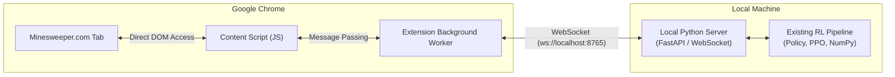

# Minesweeper RL: Comprehensive Project Context & Architecture Guide

> **HISTORICAL / SUPERSEDED.** This guide describes past revisions (including
> the old OPEN-only 10-channel / 480-action and the 960-action flag-aware
> revisions). The active project is now **FLAGS-only**: 11 observation channels
> (`FLAGGED=-2`, `HIDDEN=-1`, `OPEN=0..8`) and 1440 actions (OPEN `0..479`,
> FLAG `480..959`, CHORD `960..1439`), with recorder-v3 human data. The main
> training path has no OPEN-only switch. Where this document says "OPEN-only",
> "480 actions", "960 actions", "10 channels", `NUM_ACTIONS = 480`, or
> `minesweeper_ppo_v1`, treat it as historical. See `README.md`, `HUMAN_DATA.md`
> and the code for the current design.

> **Target Audience / Purpose**: This document is a complete, self-contained technical briefing for an AI model (such as ChatGPT) or human engineer joining the project. It provides end-to-end context on the architecture, technical decisions, completed milestones, reinforcement learning pipelines, browser automation mechanisms, test suites, and planned roadmap items (including the upcoming Chrome Extension integration).

---

## 1. Executive Summary & Vision

**Minesweeper RL** is a reinforcement learning research and engineering platform designed to train intelligent autonomous agents to solve **real-world Minesweeper** directly on live web platforms—specifically [`minesweeper.online`](https://minesweeper.online)—rather than relying solely on synthetic or toy local simulators.

### Core Objectives
1. **Real-Environment RL**: Train RL agents directly against the production web DOM of `minesweeper.online`, accounting for network latency, DOM mutations, async rendering, and anti-bot/session handling.
2. **Robust Browser Abstraction**: Create a bulletproof, deterministic environment facade (`MinesweeperEnvironment`) compliant with RL standards (observation, step, reset, reward, action masking), backed by Playwright with automatic fallbacks.
3. **Rigorous PPO Implementation**: Implement a clean, modular, task-agnostic Proximal Policy Optimization (PPO) actor-critic algorithm in PyTorch with Generalized Advantage Estimation (GAE), action masking, and entropy regularization.
4. **End-to-End Instrumentation**: Provide structured JSONL metric collection, automated performance plotting (rewards, win rates, episode lengths, mine-hit rates, losses), and non-invasive verification harnesses.
5. **Next Evolution (Chrome Extension Bridge)**: Transition from external browser automation (Playwright) to a lightweight **Manifest V3 Chrome Extension + Local Python WebSocket Server** architecture to enable on-demand interactive training directly in the user's everyday browser.

---

## 2. Repository Layout & File Structure

```text
rl minesweeper/
├── pyproject.toml                     # Package definition, dependencies (torch, playwright, numpy, pytest)
├── README.md                          # High-level project README & CLI execution examples
├── ppo_experiment.pt                  # Checkpoint from 15-episode live PPO verification run
├── test_browser.py                    # Standalone headed browser smoke test
├── browser_profile/                   # Persistent Chromium user-data directory (cookies, sessions)
│
├── src/minesweeper_rl/
│   ├── __init__.py                    # Package export root
│   ├── config.py                      # EnvironmentConfig (board size, timeouts, selectors)
│   ├── logging_config.py              # Centralized logging configuration
│   ├── metrics.py                     # Environment latency telemetry & timing context managers
│   ├── stress.py                      # Stress-testing harness for DOM synchronisation & edge cases
│   │
│   ├── browser/                       # Browser automation layer
│   │   ├── __init__.py
│   │   └── controller.py              # BrowserController: Playwright Chromium lifecycle & profile manager
│   │
│   ├── dom/                           # DOM extraction, state interpretation & validation
│   │   ├── __init__.py
│   │   ├── parser.py                  # Atomic cell extraction, coordinate mapping & NumPy array conversion
│   │   └── game_state.py              # GameStatus enum (READY, RUNNING, WON, LOST) from #top_area_face
│   │
│   ├── actions/                       # User action dispatch
│   │   ├── __init__.py
│   │   └── handler.py                 # ActionHandler: Playwright click with DOM event sequence fallback
│   │
│   ├── environment.py                 # MinesweeperEnvironment facade (observe, reveal, step, reset)
│   │
│   ├── agents/                        # RL policies, adapters, and agents
│   │   ├── __init__.py
│   │   ├── action_space.py            # Coordinate <-> action index conversion & boolean action masking
│   │   ├── policy.py                  # PolicyValueNetwork: PyTorch CNN actor-critic with one-hot inputs
│   │   ├── ppo.py                     # PPOTrainer: Complete, environment-agnostic PPO with GAE
│   │   ├── minesweeper_env.py         # MinesweeperPPOEnv: Flat-action adapter over MinesweeperEnvironment
│   │   ├── mock_env.py                # TargetCellEnv: Deterministic 1D contextual bandit for unit testing
│   │   ├── random_agent.py            # Random baseline agent for sanity checking & benchmarks
│   │   ├── experiment_ppo.py          # 15-game verified live experiment with gradient & probability checks
│   │   └── train_ppo.py               # Lightweight PPO training loop script
│   │
│   └── experiment/                    # Production experiment harness, logging, and evaluation
│       ├── __init__.py
│       ├── browser.py                 # open_environment() context manager for clean shutdowns
│       ├── metrics.py                 # EpisodeMetrics, UpdateMetrics, MetricsSummary, JSONL persistence
│       ├── tracking.py                # TrackedEnvironment: Non-invasive wrapper measuring stats & invalid actions
│       ├── train.py                   # Production train runner with signal handling & checkpointing
│       ├── evaluate.py                # Frozen-policy evaluation runner (greedy argmax, weight immutability test)
│       └── plots.py                   # Matplotlib generator for training progress & evaluation figures
│
├── tests/                             # Comprehensive test suite (125 unit tests + 10 live tests)
│   ├── README.md
│   ├── test_actions.py                # Coordinates validation, DOM event fallbacks
│   ├── test_browser_controller.py     # Playwright startup, headless rejection, lifecycle
│   ├── test_dom_parser.py             # Snapshot parsing, malformed DOM errors, cell numbers
│   ├── test_environment.py            # Core environment facade smoke tests
│   ├── test_environment_observe.py   # Two-snapshot stability checks & timeout behavior
│   ├── test_environment_reset.py     # Reset sequence, face click, controlled first move
│   ├── test_environment_step.py      # Action validation, reward calculation, termination
│   ├── test_experiment.py             # Tracking wrapper, JSONL logger, summary calculation
│   ├── test_game_state.py             # GameStatus classification rules & face prefixes
│   ├── test_minesweeper_ppo_env.py    # Flat action indexing, masking, step forwarding
│   ├── test_policy_network.py         # One-hot encoding, forward shapes, masking, autograd
│   ├── test_ppo.py                    # GAE computation, clipped surrogate, training loop on mock env
│   ├── test_random_agent.py           # Random agent mechanics, statistics formatting
│   ├── test_stress.py                 # Stress harness telemetry, recovery verification
│   ├── test_live_board_matrix.py      # [Live marker] Real site board parsing
│   ├── test_live_random_agent.py      # [Live marker] Real site random agent game
│   ├── test_live_stress.py            # [Live marker] Real site stress run
│   └── test_live_website.py           # [Live marker] Live site navigation & click validation
│
└── notebooks/
    └── README.md                      # Exploratory notebooks workspace
```

---

## 3. The Browser & DOM Environment Layer

The environment solves several notoriously difficult challenges associated with web-based reinforcement learning: DOM render latency, dynamic canvas/CSS transitions, event propagation quirks, and browser lifecycle stability.

### 3.1 Browser Control (`browser/controller.py`)
- **Technology**: Playwright Python (`sync_api`).
- **Persistent Profile**: Launches Chromium using `launch_persistent_context()` pointing to a local directory (`browser_profile/`). This preserves cookies, login sessions, and site preferences across runs.
- **Headed vs. Headless**: Enforces headed mode (`headless=False`) to avoid anti-bot detection from gaming websites and to permit user visual inspection.
- **Safe Lifecycle**: Implements explicit `start()` and `shutdown()` methods, wrapped in context managers to guarantee cleanup even upon unhandled exceptions.

### 3.2 DOM State & Board Parsing (`dom/parser.py`)
- **Site Target**: `https://minesweeper.online` (supports both standard `hd_` CSS skin and no-guessing `nnhd_` CSS skin).
- **Cell Extraction**: Uses an atomic locator evaluation (`evaluate_all`) that executes a single JavaScript function returning `{ x, y, classes }` for all elements matching `.cell[data-x][data-y]`. This prevents race conditions during DOM updates.
- **Board Encoding**:
  - `FLAGGED = -2`: Represented in DOM by `hd_flag` or `hd_closed_flag` (a player-marked covered cell).
  - `HIDDEN = -1`: Represented in DOM by `hd_closed` (an unflagged covered cell).
  - `0 .. 8`: Represented in DOM by `hd_opened` along with `hd_type0` through `hd_type8`.
  - Terminal bomb/flag states: `hd_type10`, `hd_type11`, `hd_type12` (exploded mine, revealed mine, misflagged mine) map to `HIDDEN` so post-mortem artifacts do not leak invalid action values.
  - These raw values are canonical: the environment observation and every stored dataset keep them. Channel encoding is a model-specific adapter concern (`agents/policy.py`).
- **Array Output**: Produces a strict `numpy.int8` 2D array of shape `(height, width)` (default `16 × 30` for Expert mode = 480 cells).

### 3.3 Robust DOM Synchronization & Stability
Websites do not instantly update all 480 DOM cells when a large cascade reveal occurs. To prevent reading half-rendered boards, the environment enforces:
1. **Two-Snapshot Fingerprint Matching** (`_stable_state()`): Two consecutive atomic snapshots must produce an identical fingerprint (`(x, y, sorted(classes))`) before an observation is accepted.
2. **Dynamic Change Polling** (`_wait_for_change()`): After clicking, the environment polls until either the numeric board array changes or the count of opened cells increases.
3. **Event Fallback Mechanism** (`actions/handler.py`): Revealing a cell first tries Playwright's trusted mouse click (`cell.click()`). If the site's internal JavaScript listeners do not react within `action_timeout_ms` (5000ms), it automatically falls back to synthetic DOM event dispatch:
   ```python
   cell.dispatch_event("mousedown", {"button": 0, "buttons": 1})
   cell.dispatch_event("mouseup", {"button": 0, "buttons": 0})
   cell.dispatch_event("click", {"button": 0, "buttons": 0})
   ```

### 3.4 Game Status Classification (`dom/game_state.py`)
The game outcome is detected exclusively from observable DOM state, never inferred from reward:
- Element: `#top_area_face`
- `GameStatus.WON`: Face class ends with `-top-area-face-win` (e.g. `hd_top-area-face-win`, `nnhd_top-area-face-win`).
- `GameStatus.LOST`: Face class ends with `-top-area-face-lose`.
- `GameStatus.READY`: Unpressed/pressed face and `opened_cells == 0`.
- `GameStatus.RUNNING`: Unpressed/pressed face and `opened_cells > 0`.

### 3.5 RL Interface Facade (`environment.py`)
Provides standard Gym-style interactions:
- **`step(action)`**: Accepts `(x, y)`. Validates coordinates, verifies cell is currently hidden and unflagged, executes click, waits for stable board change, derives game status, and returns:
  $$\text{step}(a) \rightarrow (s_{t+1}, r_t, \text{terminated}, \text{truncated}, \text{info})$$
  - **Reward Function** (`transition_reward`): revealed-cell progress plus a terminal bonus, where progress is the change in the number of genuinely revealed cells (`board >= 0`); `FLAGGED=-2` and `HIDDEN=-1` never count.
    - Safe reveal / chord revealing `k` cells: **`+k`** (non-terminated)
    - Flag / unflag: **`0.0`** (neutral; never depends on the hidden mine layout)
    - Mine hit (`GameStatus.LOST`): **`progress - 10.0`** (terminated)
    - Board solved (`GameStatus.WON`): **`progress + 100.0`** (terminated)
- **`reset()`**:
  - Clicks `#top_area_face` to initiate a new game.
  - Waits for navigation/refresh to a fresh, stable, 0-opened board.
  - **Controlled First Move**: Performs a deterministic first click at board center `(width // 2, height // 2)` (overrideable via `EnvironmentConfig.first_move`). Because `minesweeper.online` guarantees the first click is never a mine, the agent never starts on an all-hidden board and never suffers an immediate blind gamble loss during reset. If this guarantee ever fails, it retries up to `first_move_attempts = 3` times before raising.

---

## 4. Reinforcement Learning Architecture

### 4.1 Action Space & Masking (`agents/action_space.py`)
- **Row-Major Indexing**:
  $$\text{action} = y \times \text{width} + x, \quad x = \text{action} \pmod{\text{width}}, \quad y = \lfloor \text{action} / \text{width} \rfloor$$
  For a $30 \times 16$ board, $\mathcal{A} \in \{0, 1, \dots, 479\}$.
- **Action Masking**: An action is legal if and only if the cell is currently covered (`board[y, x] == -1`). Invalid cells are masked out by setting their policy logits to $-\infty$. This guarantees the agent never selects an already-revealed or out-of-bounds cell.

### 4.2 Neural Network Architecture (`agents/policy.py`)
`PolicyValueNetwork` is a lightweight, fully convolutional actor-critic network tailored to spatial board reasoning:

```text
Input Board: [batch, 16, 30] with values in {-2, -1, 0, 1, ..., 8}
                           │
                           ▼
One-Hot Encoding: [batch, 11, 16, 30]
  (Channel 0 = Flagged (-2), Channel 1 = Hidden (-1), Channels 2..10 = Numbers 0..8)
                           │
                           ▼
Convolutional Backbone:
  - Conv2d(10 -> 16, kernel_size=3, padding=1) + ReLU
  - Conv2d(16 -> 16, kernel_size=3, padding=1) + ReLU
                           │
             ┌─────────────┴─────────────┐
             ▼                           ▼
        Actor Head                  Critic Head
  Conv2d(16 -> 1, 1x1 conv)     AdaptiveAvgPool2d(1)
             │                           │
         Flatten                     Flatten
             │                           │
  Logits: [batch, 480]           Linear(16 -> 1)
             │                           │
  Masking (invalid -> -inf)      Value V(s): [batch, 1]
```

### 4.3 PPO Trainer Implementation (`agents/ppo.py`)
A standalone, modular PyTorch implementation of PPO adhering to modern best practices:
- **Generalized Advantage Estimation (GAE-$\lambda$)**:
  $$\delta_t = r_t + \gamma V(s_{t+1})(1 - d_t) - V(s_t)$$
  $$\hat{A}_t = \sum_{l=0}^{\infty} (\gamma \lambda)^l \delta_{t+l}$$
- **Advantage Normalization**: Advantages are normalized per batch: $\hat{A}_t \leftarrow \frac{\hat{A}_t - \mu}{\sigma + 10^{-8}}$.
- **Clipped Surrogate Objective**:
  $$L^{CLIP}(\theta) = \hat{\mathbb{E}}_t \left[ \min\left( \frac{\pi_\theta(a_t|s_t)}{\pi_{\theta_{old}}(a_t|s_t)} \hat{A}_t, \, \text{clip}\left(\frac{\pi_\theta(a_t|s_t)}{\pi_{\theta_{old}}(a_t|s_t)}, 1-\epsilon, 1+\epsilon\right) \hat{A}_t \right) \right]$$
- **Joint Loss Function**:
  $$L(\theta) = -L^{CLIP}(\theta) + c_v L^{VF}(\theta) - c_{ent} S[\pi_\theta](s_t)$$
- **Default Hyperparameters**:
  - Discount factor ($\gamma$): `0.99`
  - GAE parameter ($\lambda$): `0.95`
  - Clipping parameter ($\epsilon$): `0.2`
  - Value loss coefficient ($c_v$): `0.5`
  - Entropy bonus coefficient ($c_{ent}$): `0.01`
  - Learning rate: `3e-4` (Adam optimizer)
  - Max gradient norm: `0.5`
  - Minibatch size: `64`
  - Epochs per update: `4`
  - Checkpoint format: `minesweeper_ppo_v1`

### 4.4 Adapters & Testing Environments
- **`MinesweeperPPOEnv` (`agents/minesweeper_env.py`)**: Wraps `MinesweeperEnvironment` to translate flat integer actions into `(x, y)` tuples and manage action mask arrays.
- **`TargetCellEnv` (`agents/mock_env.py`)**: A fast, deterministic 1D contextual bandit environment with identical observation/masking interfaces, used to unit-test PPO convergence and numerical properties without browser overhead.

---

## 5. Experimentation, Metrics & Tracking

The `src/minesweeper_rl/experiment/` module houses production-grade experiment tracking, evaluation, and plotting tools:

1. **`TrackedEnvironment` (`experiment/tracking.py`)**:
   - Transparent wrapper over `MinesweeperPPOEnv`.
   - Intercepts calls to count invalid action attempts, environment failure counts, cumulative episode rewards, step counts, and duration.
2. **`MetricsLogger` (`experiment/metrics.py`)**:
   - Streams `EpisodeMetrics` and `UpdateMetrics` directly to disk in JSON Lines format (`episodes.jsonl`, `updates.jsonl`).
   - Supports seamless run resumption without holding extensive histories in memory.
3. **`train.py`**:
   - Production PPO training CLI.
   - Installs graceful signal handlers (`SIGINT`, `SIGTERM`) so interrupting a training session finishes the current episode and safely writes the checkpoint and metrics before exiting.
4. **`evaluate.py`**:
   - Frozen policy evaluation CLI.
   - Operates in pure greedy mode (`argmax` over valid action logits) under `torch.no_grad()`.
   - Uses parameter checksum verification to guarantee that model weights are byte-for-byte unmodified during evaluation.
5. **`plots.py`**:
   - Generates publication-ready multi-panel training plots (`training_progress.png`):
     - Panel 1: Episode Reward & rolling mean.
     - Panel 2: Win rate (rolling window).
     - Panel 3: Episode length (steps).
     - Panel 4: Mine-hit rate (rolling window).
     - Panel 5: PPO Policy & Value losses.
     - Panel 6: Policy Entropy & Approximate KL divergence.
   - Generates evaluation summary charts (`evaluation.png`): outcome rates (win vs mine) and per-episode averages.

---

## 6. Current Status & Verified Milestones

### 6.1 Test Suite Health
The repository has an extensive test suite:
- **125 Unit Tests Passing**:
  - Action validation and boundary checks (`test_actions.py`)
  - Browser controller lifecycle and options (`test_browser_controller.py`)
  - DOM snapshot parsing, malformed class rejections, coordinate integrity (`test_dom_parser.py`)
  - Environment observe, reset, step, and game status transitions (`test_environment_*.py`)
  - PPO GAE, clipped surrogate, minibatch updates on mock environments (`test_ppo.py`)
  - Policy network forward pass, one-hot encoding, gradient flow (`test_policy_network.py`)
  - Stress testing telemetry and recovery logic (`test_stress.py`)
- **10 Live Integration Tests** (`-m live`):
  - Verified live against `https://minesweeper.online/start/3`.

### 6.2 Live PPO Checkpoint Verification
A live verification experiment was performed directly on `minesweeper.online` using `experiment_ppo.py`. The resulting checkpoint `ppo_experiment.pt` is saved in the workspace root:
- Format: `minesweeper_ppo_v1`
- Episodes Completed: 15 live web games
- Total Steps: 56 transitions
- Actions: 480 discrete actions
- Verified: Zero invalid actions selected, valid action probabilities summing to 1.0, non-zero gradient norms on all updates, stable browser session across all 15 resets.

---

## 7. Next Major Milestone: Chrome Extension Companion Architecture

### 7.1 Motivation & Rationale
Currently, the Python process drives Chrome from the outside using Playwright CDP (Chrome DevTools Protocol). While functional, this introduces notable friction:
1. External process overhead and CDP roundtrip latency.
2. Managing persistent browser profiles on disk (`browser_profile/`).
3. Friction when wanting to train on-demand while casually browsing.

Because Chrome extensions cannot directly run Python or C libraries (NumPy, PyTorch), a **Companion Architecture** was formulated (detailed in `chrome_extension_feasibility.md`):



### 7.2 Component Responsibilities

#### Part 1: Manifest V3 Chrome Extension (JavaScript)
- **`content_script.js`**: Injected directly into `minesweeper.online`.
  - Replaces Playwright `read_cell_snapshot()`: executes `document.querySelectorAll('.cell[data-x][data-y]')` and serializes `{ x, y, classes }` into JSON.
  - Replaces `ActionHandler`: dispatches `mousedown` / `mouseup` / `click` on target cell elements.
  - Detects game status face `#top_area_face`.
- **`background.js` (Service Worker)**:
  - Maintains persistent WebSocket connection to `ws://localhost:8765`.
  - Relays board state JSON from content script to Python server.
  - Relays action commands from Python server back to content script.
- **`popup.html / popup.js`**:
  - Simple browser action UI with "Start / Stop Training", speed adjustment slider, and live statistics display (games played, win rate, current episode reward).

#### Part 2: Local Python Server (Python)
- A lightweight WebSocket or HTTP server (using `websockets`, `fastapi`, or `asyncio`).
- **No changes required to existing core code**: Receives board state JSON, runs it through `parse_board_snapshot()` into a NumPy array, passes it to `MinesweeperPPOEnv` / `PolicyValueNetwork`, and responds with `{"action": action_index, "x": x, "y": y}`.

---

## 8. Quick Reference & Common Commands

### Environment Setup
```powershell
# Install package with test and plotting dependencies
python -m pip install -e ".[test,plot]"

# Install Chromium browser binaries for Playwright
python -m playwright install chromium
```

### Running Tests
```powershell
# Run all unit tests (fast, no internet/browser required)
python -m pytest -m "not live"

# Run live integration tests against minesweeper.online
$env:MINESWEEPER_URL = "https://minesweeper.online/start/3"
python -m pytest -m live -s
```

### Running Agents
```powershell
# Run random baseline agent (20 games)
$env:MINESWEEPER_URL = "https://minesweeper.online/start/3"
python -m minesweeper_rl.agents.random_agent --games 20

# Run verified live PPO experiment (15 games with gradient checks)
python -m minesweeper_rl.agents.experiment_ppo --games 15 --checkpoint ppo_experiment.pt

# Run production PPO training with metric logging
python -m minesweeper_rl.experiment.train --games 50 --run-dir runs/train_run_1

# Run frozen policy evaluation (greedy mode)
python -m minesweeper_rl.experiment.evaluate --checkpoint runs/train_run_1/checkpoint.pt --games 20

# Run environment stress and latency profiling
python -m minesweeper_rl.stress --games 30
```

---

## 9. Key Opportunities & Next Steps for Collaboration

When discussing or continuing work on this repository with an AI or engineer, consider prioritizing the following areas:

1. **Chrome Extension Implementation**:
   - Scaffold the Manifest V3 extension directory (`manifest.json`, `content_script.js`, `background.js`, `popup.html`).
   - Implement the local Python WebSocket server bridging the extension to `MinesweeperPPOEnv`.
2. **Neural Architecture Upgrades**:
   - Upgrade the backbone from a 2-layer CNN to a Residual Network (ResNet) or add spatial attention/local self-attention to better capture constraint propagation across distant numbers.
3. **Reward Shaping & Constraint Reasoning**:
   - Current reward is sparse/coarse (+1 safe, -10 mine, +100 win). Introduce intermediate reward shaping for identifying deterministic safe cells vs. probability-based guesses.
   - Hybridize with a local Boolean Satisfiability (SAT) / CSP solver: use the solver for deterministic deduction, and train the RL agent specifically to make optimal probabilistic decisions when guessing is mathematically unavoidable.
4. **Pre-Training on Synthetic Simulator**:
   - Build a lightweight local offline Minesweeper board generator to pre-train policies over millions of steps in seconds before fine-tuning on the live web environment.
